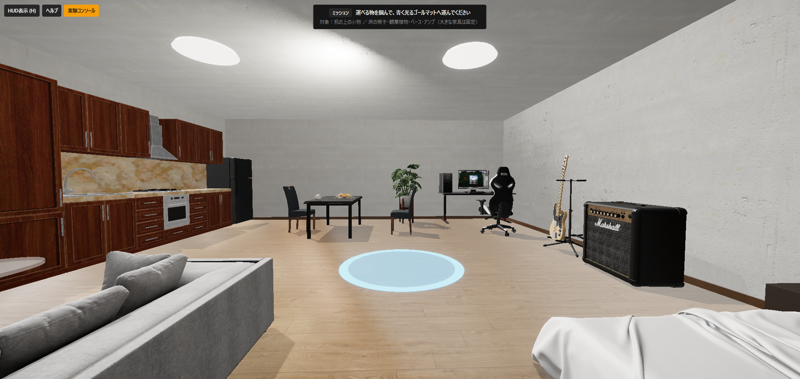
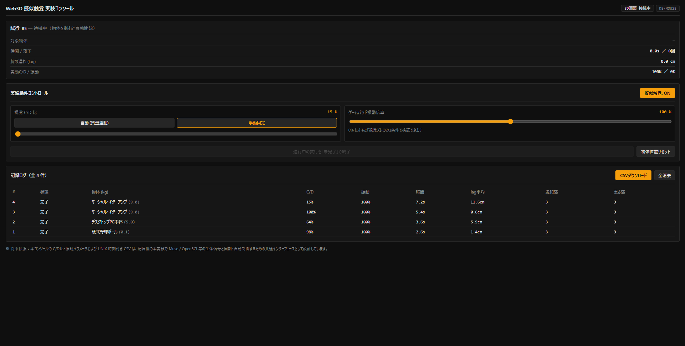

# Web3D Pseudo-Haptics Lab

Web3D 空間における「視覚の追従ズレ（C/D比制御）」と「ゲームパッド振動（Gamepad API）」を組み合わせ、身近なデバイスだけで物体の重さや手応えを再現・検証するためのブラウザ完結型プロトタイプです。

将来の生体信号（脳波・心拍変動等）を用いた閉ループ適応制御の検証を見据え、実験条件の統制・主観評価の記録・UNIX タイムスタンプ付き操作ログの CSV 出力までを一貫して行える実験基盤として構築しています。

---

## Demo

[▶ デモ動画を再生する（docs/demo.mp4）](docs/demo.mp4)

※ リンクを開いた先で再生、または「View raw」からそのままブラウザ再生できます。

### Screenshots

| 3D 実験空間（一人称） | 別ウィンドウ実験コンソール（条件統制・主観評価・CSV出力） |
| :---: | :---: |
|  |  |

---

## 主な機能

### 1. 擬似触覚（視覚 C/D 比）× 振動ハイブリッド提示
- 掴んだ物体の設定質量（kg）に応じて視覚上の手の追従速度・持ち上げ上限・移動速度を減衰させ、擬似的な重さ・抵抗感を提示します。
- 5kg 以上の重量物は自動的に両手抱えモーションへ切り替わり、手元の微細震えも重畳されます。
- Gamepad API の 2 モーター振動（dual-rumble）を質量と持ち上げ動作に連動して出力します。

### 2. 2画面分離構成の実験コンソール（BroadcastChannel 同期）
- メインの 3D 実験画面と別ウィンドウの実験コンソールをリアルタイム同期できます。
- 擬似触覚の ON / OFF、C/D 比のモード切替（質量連動 / 手動固定 15%〜100%）、振動倍率を実験者側から即座に統制できます。

### 3. 行動ログ計測 ＆ 主観評価の同期 CSV 出力
- 物体を掴んでゴールエリアへ納品するまでを 1 試行として計測し、開始/終了時刻（ISO / UNIX ms）、運搬時間、移動距離、平均/最大速度、落下回数、平均/最大ラグ（手と実入力の乖離量）を自動記録します。
- 納品直後にコンソール側で 5 段階の主観評価（違和感・重さの実感）を入力でき、客観ログと紐づけて UTF-8 CSV としてダウンロードできます。
- 記録される UNIX タイムスタンプは、外部の生体計測データ（EEG / HRV 等）との事後同期を想定しています。

### 4. DIY 家具・実験タスク配置モード
- B キーひとつで実験モードと DIY 配置モードを切り替えられ、家具・掴める物体・ゴールエリアの位置、向き、サイズ、擬似重量を自由に編集できます。
- レイアウトは JSON 形式で保存・読込できます。

---

## 操作方法

| 操作 | キーボード / マウス | ゲームパッド |
| :--- | :--- | :--- |
| 視点操作 | 画面クリックでロック → マウス移動 | 右スティック |
| 移動 | W / A / S / D（または矢印キー） | 左スティック |
| 物体を掴む・運ぶ | 左クリック長押し（または E） | RT（または A）長押し |
| しゃがむ | Space 長押し | LT / LB 長押し（または L3 切替） |
| 手の高さ調整 | マウスホイール（または R / F） | 十字キー 上 / 下 |
| 視点切替（一人称 / 三人称） | V | B |
| 擬似触覚 ON / OFF | T | Y |
| DIY 配置モード切替 | B | - |
| HUD 表示切替 | H | - |
| 落下リセット | X | X |
| カーソル復帰 | Tab / Esc | - |

---

## セットアップ ＆ 起動手順

### 動作環境
- Node.js 18 以上推奨
- モダンブラウザ（Chrome / Edge 推奨、Gamepad API 振動対応）

### ローカル起動

```bash
npm install
npm run dev